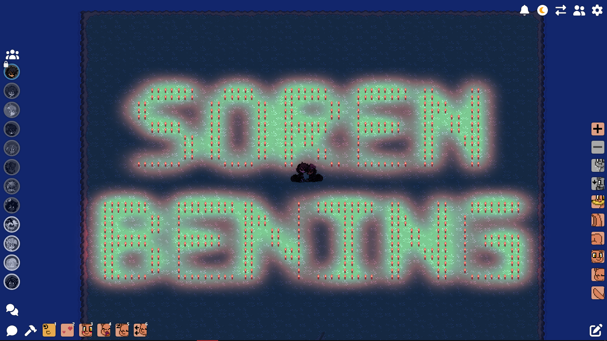

# PonyTown Text Placer

Turn any text into a grid-based pattern and place it in Pony Town automatically.



[English](#english) | [Bahasa Indonesia](#bahasa-indonesia)

```
PonyTown_Text_Placer/
├── assets/showcase.png
├── pony_town_text_placer.py
├── requirements.txt
├── START.bat
└── README.md
```

---

## English

### Recommended item

Use the **Tiny Candle** as the item to place. It is small enough to sit on a single grid cell, so every point of the pattern stays clearly separated and the lettering reads well from a distance, as in the screenshot above. Select the Tiny Candle in build mode before you start placement.

### Requirements

- Windows 10 or 11
- Python 3.10 or newer, with Tcl/Tk (included in the default installer)
- Internet access on first launch to install dependencies

### Quick start

1. Extract the ZIP into a normal folder.
2. Run `START.bat`. Missing packages (`pyautogui`, `pynput`, `pillow`) are installed automatically.
3. Choose **ID** or **EN** at the top right.
4. Type or paste your text. Press Enter for a new line.
5. Set the **Total limit** and how many items are **Already placed**.
6. Click **Show overlay**, drag it by its top bar, and match **Grid X**, **Grid Y**, and **Row offset** to the game's placement grid.
7. Drag the top-right grip to change the width and the bottom-left grip to change the height.
8. Click **Lock overlay**. A locked overlay cannot be moved and clicks pass through to Pony Town. The resize grips keep working.
9. Select the Tiny Candle in Pony Town, click **Start placement**, confirm, and switch to the game. Placement begins after a 5 second countdown.

### Characters

- Letters are converted to uppercase. Keyboard text, digits, and symbols use the built-in 5x7 pixel font, with a compact 3x5 fallback when the item limit is tight. Hearts (♡ ♥ ❤) are drawn by hand.
- Every other character (accents, Cyrillic, Greek, Chinese, Japanese, Korean, symbols, emoji) is drawn from the fonts installed on Windows through Pillow. Emoji are drawn as silhouettes.
- Typographic quotes and dashes become their plain versions. Invisible characters are ignored.
- A character that no installed font can draw appears as `?`, and the preview reports how many.
- Right-to-left scripts are drawn character by character without shaping.

### Grid modes

| Mode | Behavior |
| --- | --- |
| Balanced | Keeps the base resolution when the overlay size changes. |
| Auto limit | Density adapts to the overlay size and the remaining item limit. |
| Maximum | Uses the highest resolution that still fits the item limit. |

### Outline only

- Turn on **Outline only** to place just the border of every character and leave the inside empty. The same item limit then carries a bigger pattern.
- Pixel font strokes are one cell wide at 1.00x, so letters only hollow out once the pattern is enlarged to about 3x or more. Maximum does this by itself when the item limit is high enough, and Auto limit follows the overlay size. Solid shapes such as hearts and CJK characters hollow out right away.

### Repair

- Click **Repair** on the overlay's top bar, then hold the cursor still over an empty point for about 0.35 seconds to click it once.
- Each point can be repaired once per activation. Turn Repair off and on to try the same point again.

### Controls and safety

- `ESC` stops placement or turns off Repair. `F8` shows or hides the overlay.
- Moving the mouse into a screen corner also aborts placement (PyAutoGUI fail-safe).
- Inputs are locked while placing. Changing the text, item limits, line gap, alignment, grid mode, or outline setting resets the attempt progress kept in memory.
- **Reset** next to **Grid and overlay** restores Grid X/Y, Row offset, Line gap, the overlay size, and a centered position.
- A sent click does not confirm that the game placed an item. Do not change the browser zoom or window size after calibrating, and test with a small pattern first.

---

## Bahasa Indonesia

### Item yang direkomendasikan

Gunakan **Tiny Candle** sebagai item yang ditempatkan. Ukurannya cukup kecil untuk satu sel grid, sehingga setiap titik pola tetap terpisah jelas dan tulisan mudah terbaca dari jauh, seperti pada tangkapan layar di atas. Pilih Tiny Candle di mode bangun sebelum memulai penempatan.

### Kebutuhan

- Windows 10 atau 11
- Python 3.10 atau lebih baru, dengan Tcl/Tk (sudah termasuk di installer bawaan)
- Koneksi internet saat pertama kali dijalankan untuk memasang dependensi

### Mulai cepat

1. Ekstrak ZIP ke folder biasa.
2. Jalankan `START.bat`. Paket yang belum ada (`pyautogui`, `pynput`, `pillow`) dipasang otomatis.
3. Pilih **ID** atau **EN** di kanan atas.
4. Ketik atau tempel teks. Tekan Enter untuk baris baru.
5. Atur **Limit total** dan jumlah item yang **Sudah terpasang**.
6. Klik **Tampilkan overlay**, geser lewat bilah atasnya, lalu samakan **Grid X**, **Grid Y**, dan **Offset baris** dengan grid penempatan di game.
7. Tarik pegangan kanan atas untuk mengubah lebar dan pegangan kiri bawah untuk mengubah tinggi.
8. Klik **Kunci overlay**. Overlay yang terkunci tidak bisa digeser dan klik diteruskan ke Pony Town. Pegangan resize tetap berfungsi.
9. Pilih Tiny Candle di Pony Town, klik **Mulai penempatan**, konfirmasi, lalu pindah ke game. Penempatan dimulai setelah hitung mundur 5 detik.

### Karakter

- Huruf otomatis menjadi kapital. Teks, angka, dan simbol keyboard memakai font piksel 5x7 bawaan, dengan cadangan ringkas 3x5 saat limit item sempit. Hati (♡ ♥ ❤) digambar manual.
- Karakter lain (aksen, Cyrillic, Yunani, Mandarin, Jepang, Korea, simbol, emoji) digambar dari font yang terpasang di Windows lewat Pillow. Emoji digambar sebagai siluet.
- Tanda kutip dan tanda hubung tipografis diubah menjadi versi biasa. Karakter tak terlihat diabaikan.
- Karakter yang tidak bisa digambar oleh font terpasang muncul sebagai `?`, dan pratinjau melaporkan jumlahnya.
- Aksara kanan-ke-kiri digambar per karakter tanpa pembentukan huruf (shaping).

### Mode grid

| Mode | Perilaku |
| --- | --- |
| Sesuai | Mempertahankan resolusi dasar saat ukuran overlay berubah. |
| Auto Limit | Kepadatan menyesuaikan ukuran overlay dan sisa limit item. |
| Maksimum | Memakai resolusi tertinggi yang masih muat dalam limit item. |

### Hanya outline

- Aktifkan **Hanya outline** untuk menempatkan garis tepi setiap karakter saja dan membiarkan bagian dalamnya kosong. Dengan limit item yang sama, pola bisa lebih besar.
- Goresan font piksel selebar satu sel pada 1,00x, jadi huruf baru berlubang setelah pola diperbesar sekitar 3x atau lebih. Maksimum melakukannya sendiri jika limit item cukup tinggi, dan Auto Limit mengikuti ukuran overlay. Bentuk padat seperti hati dan karakter CJK langsung berlubang.

### Perbaikan

- Klik **Perbaiki** di bilah atas overlay, lalu tahan kursor di titik kosong sekitar 0,35 detik untuk mengkliknya sekali.
- Setiap titik hanya bisa diperbaiki sekali per pengaktifan. Matikan lalu aktifkan Perbaiki untuk mencoba titik yang sama lagi.

### Kontrol dan keamanan

- `ESC` menghentikan penempatan atau mematikan Perbaiki. `F8` menampilkan atau menyembunyikan overlay.
- Menggerakkan mouse ke sudut layar juga membatalkan penempatan (fail-safe PyAutoGUI).
- Input dikunci saat penempatan berjalan. Mengubah teks, limit item, jarak baris, perataan, mode grid, atau pengaturan outline mereset progres percobaan di memori.
- **Reset** di samping **Grid dan overlay** mengembalikan Grid X/Y, Offset baris, Jarak baris, ukuran overlay, dan posisi tengah.
- Klik yang terkirim bukan konfirmasi bahwa game berhasil memasang item. Jangan ubah zoom browser atau ukuran jendela setelah kalibrasi, dan uji dulu dengan pola kecil.
